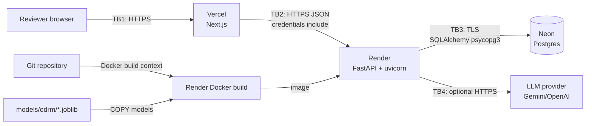

# Valoris Dataflow - Deployment Scope

| | |
|---|---|
| Status | Sprint 12A deployment-scoped baseline |
| Last reviewed | 2026-11-28 |
| Related | `docs/THREAT_MODEL.md`, `docs/SECURITY.md`, `docs/DEPLOYMENT.md` |

This diagram covers the public deployment path only. It shows where data is created,
transmitted, stored, and optionally sent to an LLM provider.

---

## 1. Runtime dataflow

### 1.1 Trust boundaries

| ID | Boundary | Data crossing | Protection |
|---|---|---|---|
| TB1 | Browser -> Vercel | HTTPS requests, HTML/JS bundles | TLS; no secrets in the bundle. |
| TB2 | Vercel -> Render | JSON requests, `odrm_access_token` cookie | TLS; CORS allowlist; `HttpOnly`/`Secure`/`SameSite=None`; CSRF origin check. |
| TB3 | Render -> Neon | SQL queries and results | TLS (`sslmode=require`); secret URL; least-privilege DB user. |
| TB4 | Render -> LLM provider | User chat text, selected context, model response | HTTPS; provider API key; no secrets in prompts. |
| TB5 | Git -> image | Source, migrations, model artifacts | `.dockerignore`; committed model review; non-root runtime. |

---

## 2. Data classes

| Data | Source | Destination | Persistence | Notes |
|---|---|---|---|---|
| Admin email | Operator | Neon `users` | Until demo teardown | Used for login. |
| Admin password | Operator | Argon2 hash in Neon | Until demo teardown | Plaintext never stored or logged. |
| JWT session | Render | Browser cookie | Session lifetime | `HttpOnly`, `Secure`, `SameSite=None`, `Path=/api/v1`. |
| Prediction conditions | Reviewer | Render -> model | Request only; may be included in evidence rows | Validated against schema bounds. |
| Prediction output | Render | Reviewer | Request only; may be included in evidence rows | Includes model version. |
| TEA assumptions and results | Reviewer | Render -> Neon evidence | Evidence retention | Commercial assumptions; demo data only. |
| Report | Render | Reviewer download | Generated on demand | Contains the screening result and disclaimer. |
| Chat messages | Reviewer | Render -> LLM | Request only; not persisted by Valoris | Optional; provider retention is provider-controlled. |
| Model artifacts | Git | Render image | Image lifetime | Two joblib files; no runtime download. |
| Application logs | Render | Render logs | Platform retention | Must not contain secrets or full request bodies. |

---

## 3. Request flows

### 3.1 Login

1. Browser sends `POST /api/v1/auth/login` from the Vercel origin.
2. Render validates credentials against the Argon2 hash in Neon.
3. Render returns a JWT and sets `odrm_access_token` with `HttpOnly`, `Secure`,
   `SameSite=None`, `Path=/api/v1`.
4. Browser sends the cookie on subsequent credentialed requests.

### 3.2 Prediction and TEA

1. Browser sends authenticated `POST /api/v1/predict` or `POST /api/v1/tea`.
2. Render validates the schema and origin.
3. The model artifacts in `/app/models/odrm` produce predictions.
4. TEA computes financials deterministically.
5. Evidence is recorded in Neon; the response includes `X-Evidence-Status: recorded`.
6. No LLM is required for these paths.

### 3.3 Chat (optional)

1. Browser sends authenticated `POST /api/v1/chat`.
2. Render builds the LLM client from `ODRM_LLM_PROVIDER`, `ODRM_LLM_MODEL`, and
   `ODRM_LLM_API_KEY`.
3. The prompt is sent to the provider over HTTPS.
4. The response is returned to the browser; Valoris does not persist the chat transcript.
5. If the key is absent or invalid, the chat endpoint fails without affecting prediction,
   TEA, or report.

### 3.4 Report

1. Browser requests an authenticated report.
2. Render generates the PDF from the current screening/evidence data.
3. The PDF is returned as a download; it is not stored in public object storage.

---

## 4. Storage and retention

| Store | Contents | Retention | Access |
|---|---|---|---|
| Neon `users` | Admin email, Argon2 hash, role | Until demo teardown | Application DB user; operator via Neon console. |
| Neon evidence tables | Prediction/TEA inputs, outputs, hashes | Demo lifetime; define teardown date | Application DB user; operator via Neon console. |
| Render logs | Request metadata, startup logs | Platform retention | Render account operators. |
| Browser cookie | JWT session | Session/expiry | Reviewer browser; `HttpOnly`. |
| Docker image | Code, migrations, model artifacts | Image lifetime | Render build/runtime. |
| LLM provider | Chat prompts/responses | Provider policy | Provider account; not controlled by Valoris. |

The demo does not collect end-user PII beyond the seeded admin email. If real operator
data is introduced later, this document and `docs/SECURITY.md` must be updated before use.

---

## 5. Teardown

1. Delete the Vercel project.
2. Delete the Render service.
3. Delete the Neon project or database.
4. Revoke the LLM API key.
5. Remove any local `.env` files and shell variables containing deployment secrets.
6. Record the teardown date in the deployment log.
