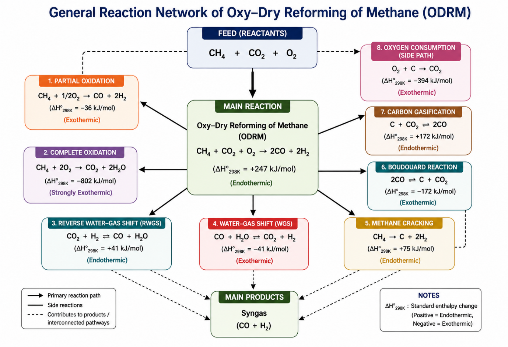
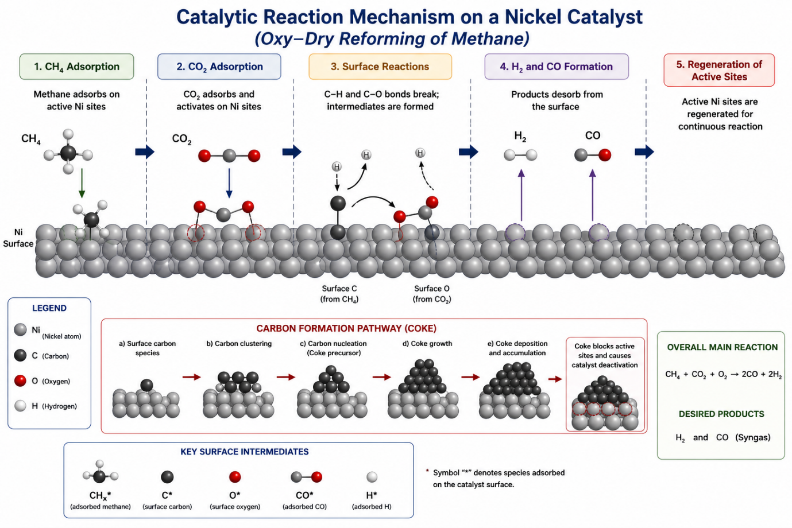
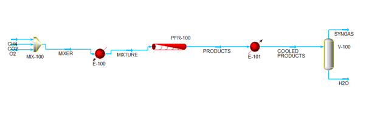
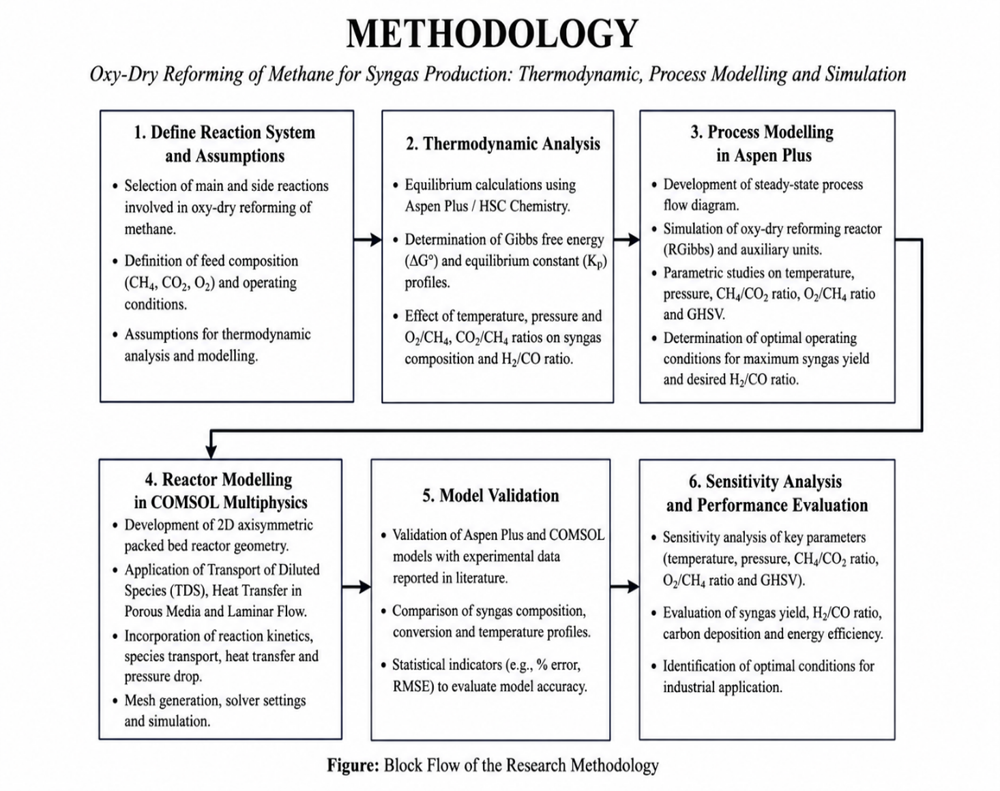

# ODRM Reference: Oxy-Dry Reforming of Methane for Syngas Production

**Author:** Agbu Simon Wunukahobe
**Institution:** Abubakar Tafawa Balewa University, Bauchi
**Type:** Masters of Engineering Research Project (July 2026)

---

## 🚨 CTO DIRECTIVE TO OPENCODE (READ THIS FIRST)
This document is the **physics engine** for the ODRM-Copilot synthetic data generator.
When generating data or setting ML bounds, you MUST adhere to the following extracted rules:
1. **Temperature Bounds:** Minimum `500°C`, Optimal `750°C - 900°C`, **Hard Maximum `1000°C`**.
2. **Pressure Bounds:** Near atmospheric. `1 bar` to `30 bar`.
3. **Primary Goal:** Maximize Syngas (H2 + CO) while minimizing Carbon Deposition.
4. **Carbon Deposition:** Occurs primarily via Methane Cracking (favored at high temp) and Boudouard Reaction (favored at low temp).

---

## 1. The Reaction System (ODRM)
Oxy-Dry Reforming (ODRM) combines Dry Reforming of Methane (DRM) and Partial Oxidation of Methane (POM) in a single reactor.

### 1.1 Primary Reactions
*   **Dry Reforming of Methane (DRM) - Endothermic:**
    `CH4 + CO2 ⇌ 2CO + 2H2`  *(ΔH = +247 kJ/mol)*
*   **Partial Oxidation of Methane (POM) - Exothermic:**
    `CH4 + 0.5O2 → CO + 2H2` *(ΔH = -36 kJ/mol)*

### 1.2 Side Reactions (The Safety Risks)
*   **Methane Cracking (MC) - Causes Carbon Deposition:**
    `CH4 → C(s) + 2H2` *(ΔH = +75 kJ/mol)*
*   **Boudouard Reaction (BDR) - Causes Carbon Deposition:**
    `2CO ⇌ CO2 + C(s)` *(ΔH = -172 kJ/mol)*
*   **Reverse Water-Gas Shift (RWGS) - Reduces H2/CO ratio:**
    `CO2 + H2 ⇌ CO + H2O` *(ΔH = +41 kJ/mol)*
*   **Complete Oxidation - Wastes Syngas Yield:**
    `CH4 + 2O2 → CO2 + 2H2O` *(ΔH = -802 kJ/mol)*

*Figure 2.6: General reaction network of ODRM showing primary and side reactions.*

---

## 2. Thermodynamics & Operating Envelopes
*(This section dictates the `BOUNDS` in `backend/src/odrm/data/schema.py`)*

*   **Temperature Effect:**
    *   Below `700°C`: Methane conversion is low; carbon deposition is high.
    *   `800°C - 950°C`: High methane/CO2 conversion, high syngas yield.
    *   Above `900°C`: Catalyst sintering begins. Thermal limits of reactor materials are reached.
    *   *Optimum:* `800°C - 900°C`.
*   **Pressure Effect:**
    *   Because DRM produces 4 moles of gas from 2 moles of reactant, low pressure favors syngas production. 
    *   *Optimum:* Near atmospheric (`1 - 5 bar`). Up to `30 bar` for downstream processing.
*   **Feed Ratio (CH4/CO2/O2):**
    *   Higher CO2 ratio suppresses carbon formation.
    *   Higher O2 ratio supplies heat (POM) but risks complete combustion (wasting syngas).
*   **Space Velocity (GHSV):**
    *   Too high = incomplete conversion. Too low = unnecessary energy use. 

---

## 3. Catalyst Dynamics
*   **Catalyst Type:** Nickel-based (Ni/Al2O3 or Ni-MgO).
*   **The Coking Problem:** Nickel is highly active but highly susceptible to carbon deposition (coke), which blocks active sites and deactivates the catalyst.
*   **Mitigation:** Adding promoters (Cerium, Lanthanum) improves oxygen mobility, helping to gasify carbon.

*Figure 2.7: Catalytic reaction mechanisms on a Nickel catalyst showing carbon formation pathways.*

---

## 4. Process Flow Diagram (PFD)
The simulation architecture required for Aspen HYSYS.
1.  **MIX-100:** Mixer for CH4, CO2, and O2 feeds.
2.  **E-100:** Heater (brings mixture to reaction temperature).
3.  **PFR-100:** Plug Flow Reactor (where the ODRM reactions occur).
4.  **E-101:** Cooler (cools the product stream).
5.  **V-100:** Separator (separates Syngas from Water).

*Figure 2.9: Process flow diagram of Oxy-Dry Reforming of Methane.*

---

## 5. Methodology & Simulation Stack
The thesis uses three integrated tools. For the ODRM-Copilot, we are building a Surrogate AI to replace the need for engineers to manually navigate these tools.

1.  **HSC Chemistry:** Thermodynamic equilibrium analysis (Gibbs free energy minimization).
2.  **Aspen HYSYS:** Steady-state process simulation and sensitivity analysis.
3.  **COMSOL Multiphysics:** 2D/3D finite element analysis of heat and mass transfer inside the reactor.

*Figure 3.1: Block Flow of the Research Methodology.*